<div align="center">



# 🌐 Web Fundamentos · Working Tech 2026

**Workshop prático de HTML, CSS e JavaScript: do zero ao seu primeiro portfólio no ar.**


</div>

---

## 👋 Sobre o workshop

O **Web Fundamentos** é um workshop da **Working Tech 2026 (Unicesumar)**. A ideia é simples: aprender os pilares da web **construindo algo real**. Você não fica só na teoria: ao longo do encontro, a gente monta juntos um **site de portfólio pessoal**, do HTML puro até a interatividade com JavaScript.

No final, cada participante sai com:

- ✅ Uma página de portfólio própria, responsiva e com tema claro/escuro
- ✅ Noção clara de como **HTML, CSS e JS** conversam entre si
- ✅ O código versionado no **GitHub**, pronto pra mostrar pra quem quiser

> Ministrado por **Paulo Ricardo**, desenvolvedor Full Stack.

---

## 🧱 O que vamos aprender

| Pilar | Papel na página | O que vemos no workshop |
|---|---|---|
| 🟧 **HTML** | A estrutura | Tags semânticas (`header`, `main`, `section`, `footer`), imagens, listas, formulários |
| 🟦 **CSS** | A aparência | Seletores, cores, Flexbox, layout responsivo, imagens de fundo, tema escuro com classes |
| 🟨 **JavaScript** | O comportamento | `getElementById`, eventos (`click`, `submit`), manipulação do DOM, `classList` |
| ⬛ **GitHub** | O portfólio | Versionar o projeto e publicar seu código |

---

## 🚀 O projeto: Meu Currículo

O site deste repositório é o resultado final do workshop. Ele tem:

- 🏠 **Hero**: foto, nome, cargo e chamada pro portfólio
- 🙋 **Sobre mim**: uma breve apresentação
- 🛠️ **Habilidades**: as tecnologias que você domina, com ícones
- 🎠 **Carrossel de projetos**: cards navegáveis com setas, que voltam ao início no fim
- ✉️ **Formulário de contato**: com mensagem de agradecimento personalizada
- 🌗 **Tema claro / escuro**: alternado com um clique

---

## 📁 Estrutura

```
📦 Workingtech-2026
 ┣ 📂 img           → imagens, ícones e fundos
 ┣ 📜 index.html    → estrutura da página
 ┣ 🎨 style.css     → estilos e tema escuro
 ┣ ⚙️ script.js     → tema, carrossel e formulário
 ┗ 📘 README.md
```

---

## ▶️ Como rodar

Não precisa instalar nada! 🎉

```bash
# 1. Clone o repositório
git clone https://github.com/PaulinDevendo/Workingtech-2026.git

# 2. Entre na pasta
cd Workingtech-2026

# 3. Abra o index.html no navegador
```

💡 **Dica:** no VS Code, instale a extensão **Live Server** e clique em *Go Live*. A página atualiza sozinha toda vez que você salva.

---

## 🧠 Spoiler do JavaScript

Um gostinho do que a gente faz no workshop. Com poucas linhas, a página ganha um tema escuro:

```js
const botaoTema = document.getElementById("botao-tema");

botaoTema.addEventListener("click", function () {
    document.body.classList.toggle("escuro");
});
```

Simples assim: o JS só **liga e desliga uma classe**, e o CSS cuida do resto. 😎

---

## 🎯 Desafios pós-workshop

Terminou e quer ir além? Tenta estes:

- [ ] Troque as informações pelas **suas**: foto, nome, habilidades e projetos
- [ ] Faça os links do menu levarem até cada seção (`href="#sobre"`)
- [ ] Salve o tema escolhido com `localStorage`
- [ ] Publique seu site de graça com **GitHub Pages**
- [ ] Crie uma nova seção (experiência, certificados...)

---

<div align="center">

Feito com 💙 no **Workshop Web Fundamentos · Working Tech 2026**

⭐ Se curtiu, deixa uma estrela no repositório!

</div>
